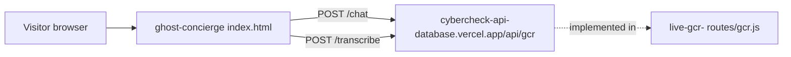

# ghost-concierge

A single-page marketing site for "Ghost Concierge", a voice and text AI guide to the Gulf Coast, with a small chat and voice demo box.

## What it is

One static HTML page (`index.html`, titled "Ghost Concierge — Your Personal Gulf Coast Guide"). It sells the idea of an AI concierge that rewards users with tokens, and includes a live demo box that talks to an outside API. There is no backend or product code in this repo.

## How it works

- Everything lives in `index.html`; no build step, no `package.json`.
- The script sets `const API = 'https://cybercheck-api-database.vercel.app/api/gcr'`.
- Typed messages are POSTed as JSON (`message` plus the last 10 history entries) to `${API}/chat`.
- Voice recordings are POSTed as form data field `audio` to `${API}/transcribe`.
- The token balance is a client-side JavaScript variable (`let tokens = 0`) that resets on reload; it is not stored anywhere.
- Business counts ("820+ Local Businesses") and provider cards are hard-coded marketing copy.
- The `/chat` and `/transcribe` routes are implemented in the live-gcr- repo (`routes/gcr.js`).

## Run it

```sh
# open the page directly, or serve the folder
python3 -m http.server 8000     # then visit http://localhost:8000
```

No environment variables. The demo box only works while the external API above is live.

## Status

Stalled: a finished-looking landing page whose demo depends on another repo's API; no token logic or backend exists here.

## Where it fits



## Related repos

- live-gcr-: holds the `/api/gcr` routes (`/chat`, `/transcribe`) this page calls.
- cybercheck-api-database: the API host name the page points at.
- ghost-ai and the gcr-* repos: the wider Ghost / Gulf Coast Radar family this page markets.
